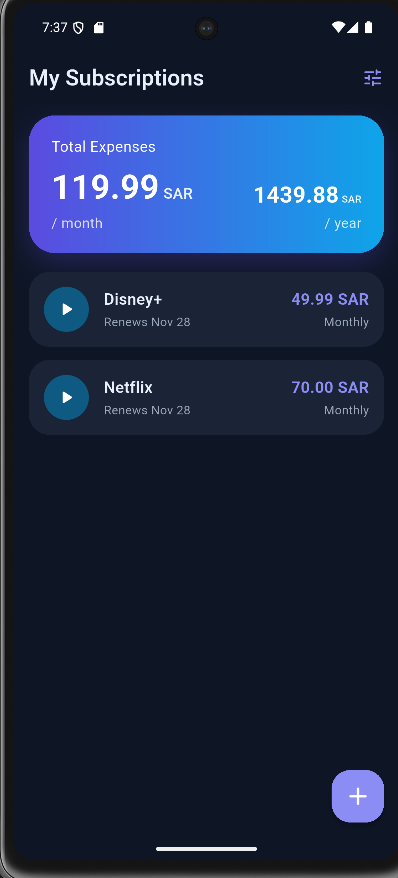
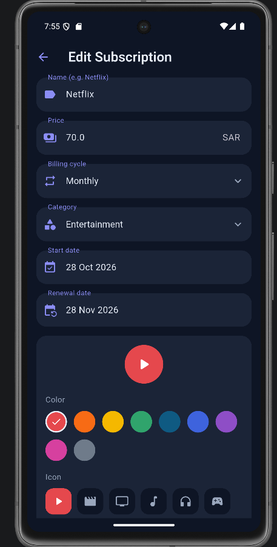

# My Subscription

   

A Flutter mobile app that helps users manage and track their subscriptions (Netflix, OSN, Spotify, Disney+ ...), renewal dates, and how much they spend every month and year.

## Overview
My Subscription is a student project that keeps all of a person's subscriptions in one place. The user creates a local account, adds subscriptions (price, billing cycle, renewal date, group, color and icon) and the app shows the next renewals and the total cost per month and per year. All data is stored on the device, so no server or internet connection is needed.

## Screenshots

| Home | Add / Edit |
|------|------------|
|  |  |

## Problem Statement
Users may forget their subscriptions, renewal dates, or how much they spend.

## Objectives
- Add and manage subscriptions.
- Track renewal dates.
- Calculate monthly and yearly costs.
- View all subscriptions in one place.

## Features
- Add, edit, and delete subscriptions (swipe left to delete, with Undo).
- Billing cycles: monthly, quarterly, yearly.
- Next renewal date ("Renews in X days"), sorted by the nearest renewal.
- Total monthly and yearly cost (cancelled subscriptions are excluded).
- Custom color and icon for every subscription.
- Split subscriptions into groups (Personal, Work, Home, Family or your own) and filter by group; totals follow the selected group.
- Light and dark theme (or follow the system).
- English and Arabic, with full right-to-left layout.
- Create an account and log in; every user sees only his own subscriptions.
- Passwords are saved as a salted SHA-256 hash, never as plain text.
- Data is saved on the device (no internet needed).

## Tech Stack
- Flutter (Dart), Material 3
- `shared_preferences` for local storage
- `crypto` for password hashing
- `flutter_localizations` for English / Arabic

## Getting Started
```bash
git clone https://github.com/MohammedAlsubaie/my-subscription.git
cd my-subscription
flutter pub get
flutter run
```

## Testing
```bash
flutter analyze   # static analysis
flutter test      # unit tests (cost calculation, groups)
```

## Resource Folder Information

```
mysub/
├── lib/                      # All the Dart source code
│   ├── main.dart             # App entry point, theme and language setup
│   ├── home_screen.dart      # Main screen: totals + list of subscriptions
│   ├── subscription_form_screen.dart  # Add / edit screen (color and icon picker)
│   ├── subscription.dart     # Subscription model, billing cycles, cost calculation
│   ├── subscription_tile.dart         # One subscription card in the list
│   ├── summary_card.dart     # Gradient card with monthly / yearly totals
│   ├── settings_sheet.dart   # Theme and language settings sheet
│   ├── settings_controller.dart       # Saves theme / language choices
│   ├── auth_screen.dart      # Login / create account screen
│   ├── auth_service.dart     # Accounts: register, login, logout, password hash
│   ├── storage_service.dart  # Saves and loads subscriptions of one user
│   ├── app_theme.dart        # Light and dark color palettes
│   ├── strings.dart          # English and Arabic texts
│   └── date_utils.dart       # Date helpers (add months, format date)
├── android/                  # Android project (build files)
│   └── app/src/main/res/     # Android resources
│       └── mipmap-*/         # App launcher icon in all sizes
├── test/                     # Tests
├── screenshots/              # Images used in this README
└── pubspec.yaml              # Dependencies and project settings
```

The app uses no external image files. Its icons come from the built-in Material Icons, and the launcher icon is stored in `android/app/src/main/res/mipmap-*`.

## Application Deployment Method

### Requirements
- Flutter SDK (3.x or newer)
- Android Studio with an Android emulator or a real Android phone
- Git

### Run in development
```bash
git clone <your-repository-link>
cd mysub
flutter pub get
flutter run
```
Choose an emulator or a connected phone when asked.

### Build the Android app (APK) for installing on a phone
```bash
flutter build apk --release
```
The file is created at `build/app/outputs/flutter-apk/app-release.apk`. Copy it to an Android phone and open it to install (allow "install from unknown sources" if asked).

### Build for Google Play (App Bundle)
```bash
flutter build appbundle --release
```
The file `build/app/outputs/bundle/release/app-release.aab` can be uploaded to the Google Play Console.

## Contributing
Issues and pull requests are welcome. Please run `flutter analyze` and `flutter test` before opening a pull request.

## Limitations
- Accounts and data are stored only on the device (no cloud sync between devices).
- Renewal reminders (notifications) are not implemented yet.

## License
No license specified. This is a university project.

## Author
Student project - My Subscription
